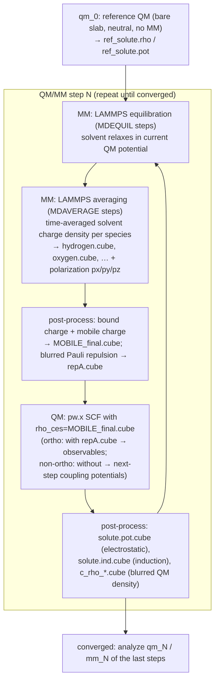

# 01 — DFT-CES2 Overview

<!-- TODO: expand prose. Skeleton with the load-bearing diagram and section stubs. -->

## What DFT-CES2 does

DFT-CES2 (DFT in Classical Explicit Solvent, v2) couples a periodic DFT
calculation of an electrode slab (**QM region**, Quantum ESPRESSO) with a
classical MD simulation of the electrolyte (**MM region**, LAMMPS) through
*mean-field* coupling: instead of exchanging forces every MD step, each side
hands the other a **time-averaged density/potential on a 3D grid** (Gaussian
`.cube` files), and the two are iterated to self-consistency.

## The outer loop

One "QM/MM step" `N` produces one `qm_N/` and one `mm_N/` directory:

Key points first-timers usually miss:

- **Step 0 is special.** `qm_0` is the isolated (no MM, neutral) slab — it is the
  *reference* that later steps subtract to isolate the solvent-induced change.
  There is no meaningful `mm_0` physics before it; the loop needs qm_0's
  `ref_solute.*.cube` files.
- **Two pw.x runs per step** ("ortho" and "non-ortho") — see
  [glossary](glossary.md) and [04 — Output files](04-output-files.md#qm-stage).
- **Convergence** is judged by the stability of observables (work function,
  density profiles) across successive steps, not by an automatic criterion.

## QM and MM regions

<!-- TODO: figure — slab (QM, replicated SUPERCELL times in MM box) + electrolyte (MM).
     Explain: QM cell = 1 unit cell; MM box = supercell; forces/densities are
     folded back per unit cell. Atom bookkeeping: MM atoms have LAMMPS id 1..NSOLVATOM,
     slab atoms come after. -->

## Charged electrodes

<!-- TODO: explain TOTCHG (per QE unit cell), the point-charge (MDIPC) and
     plate (CHGPLATE) neutralization schemes, and dipole correction.
     See 03-qmmm-script-reference.md §6 for the knobs. -->

## Where everything lives

- Builder & config: [main README](../README.md)
- Generated run script variables: [03](03-qmmm-script-reference.md)
- Files produced during a run: [04](04-output-files.md)
